<!-- Profile README for github.com/Jnana1964/Jnana1964 -->

 

---

## About

- 🎓 B.Tech in Computer Science and Engineering at **SRM Institute of Science and Technology**, CGPA **9.18**, graduating **2027**
- 🧱 I build full-stack products and the services underneath them, then try to break them: concurrent requests against atomic Redis scripts, k6 load tests, and nodes killed in the middle of a run
- 🤖 I build products around language models where the model is one part of the system, and a deterministic engine makes sure generated text never overrides results I can verify
- 🔬 Presented at **ICSIE 2026**, reviewer at **SASIGD 2026**
- 🚧 Currently working on a medical-AI research prototype (see below). It is in progress and has no results yet
- 🔎 Looking for **Software Development Engineer** roles and internships starting in 2027

---

## Tech Stack

**Languages**

**Frontend**

**Backend and Databases**

**DevOps, Testing and Tooling**

**AI in production**

**ML coursework**

**Analysis and collaboration**

**Learning and next up**

---

## Projects (in the order I built them)

| | Project | What it does | Stack | Links |
|---|---|---|---|---|
| **2025** | **EcoResonanceAI** (Nov 2025) | Live Open-Meteo, NASA POWER and USGS feeds combined into the **EcoResonance Index**, a documented composite of seven normalised parameters with configurable weights, rendered as a dashboard with live map, history and alert views. Paper presented at ICSIE 2026. The index is a transparent weighted model, not a black box, and the project does not claim to predict disasters | `JavaScript` `Leaflet` `Chart.js` `Open-Meteo` `NASA POWER` `USGS` | [Code](https://github.com/Jnana1964/EcoResonanceAI) |
| **2026** | **Rate Limiter Gateway** (Jul – Sep) | Token bucket, sliding window log and sliding window counter as atomic Redis Lua scripts. Zero over-allowance at 50 concurrent requests per algorithm, then about **1,300 req/s** at **p95 107 ms** over 197,402 requests, with 6/6 automated tests passing | `Node.js` `Express` `Redis` `MySQL` `JWT` `Docker` `k6` | [Live](https://rate-limiter-gateway-tb6n.onrender.com/) · [Code](https://github.com/Jnana1964/rate-limiter-gateway) |
| | **PrepWise AI** (Aug – Sep) | Resume analysis, ATS scoring, job matching, assessments and AI mock interviews across a 12-table schema. Gemini runs server-side; a deterministic scoring engine keeps model output from overriding verifiable results. **Try it with the demo account below** | `React` `Tailwind` `Express` `Sequelize` `MySQL` `JWT` `Gemini API` | [Live](https://prepwise-ai-1-zm7p.onrender.com/) · [Code](https://github.com/Jnana1964/prepwise-ai) |
| | **Distributed Key-Value Store** (Aug) | Five nodes, consistent hashing with 150 virtual nodes each, quorum replication (N=3, W=2, R=2), read-repair and a write-ahead log, tested by killing a node during a k6 load run | `Java` `Spring Boot` `Docker Compose` `JUnit 5` `k6` | [Code](https://github.com/Jnana1964/kv-store) |
| | 🚧 **Medical Cross-Attention Transformer using Agentic AI** (Nov 2026 – May 2027, ongoing) | Research prototype for skin-lesion classification that fuses dermoscopic images with patient metadata, built to keep working when metadata is missing and to refer low-confidence cases. **In progress, no results yet. Not a diagnostic tool and not for clinical use** | `ViT/Swin` `LangGraph` `Ollama` `FastAPI` `React` `PostgreSQL` | Repository coming |

> **Try PrepWise AI without signing up:** open the [live app](https://prepwise-ai-1-zm7p.onrender.com/login) and sign in with `demo@prepwise.ai` / `demopass123` for a fully populated account — analysed resume, 14 tracked applications, 3 mock interviews, 5 company assessments and 90 days of performance history. Free-tier hosting, so the first load can take up to a minute. Prefer a clean start? [Create your own account](https://prepwise-ai-1-zm7p.onrender.com/signup).

---

## Research and Credentials

<b>Publications and reviewing</b>

- **ICSIE 2026 (presented):** "EcoResonanceAI: A Real-Time Environmental Risk Monitoring System Using Multi-Source Data", 17th International Conference on Science & Innovative Engineering, with Manipal University College, Malaysia
- **ICRCET 2025 (accepted):** "Recommendation System for Netflix"
- **SASIGD 2026:** invited reviewer

<b>Certifications</b>

- Oracle Cloud Infrastructure Certified Architect Associate (Aug 2026)
- AWS Training & Certification: Data Engineering on AWS, Foundations (course completion, Aug 2025)
- Claude with the Anthropic API (certificate of completion)
- Google AI Essentials, Coursera (Jul 2026)
- NPTEL: Machine Learning
- NPTEL: Natural Language Processing
- Tata (Forage): Data Visualisation virtual experience

<b>Hackathons</b>

- Byte Verse Hackathon, NIT Patna (2024)
- CodeClash (2025)

---

## GitHub Stats

  
  

  

## Contribution Activity

  <picture>
    <source media="(prefers-color-scheme: dark)" srcset="https://raw.githubusercontent.com/Jnana1964/Jnana1964/output/github-snake-dark.svg" />
    <source media="(prefers-color-scheme: light)" srcset="https://raw.githubusercontent.com/Jnana1964/Jnana1964/output/github-snake.svg" />
    
  </picture>

---

## Let's Connect

I am looking for **Software Development Engineer** roles and internships starting in 2027. The fastest way to reach me is [email](mailto:jnanabollu@gmail.com), or see my work at [jnana1964.github.io](https://jnana1964.github.io).

